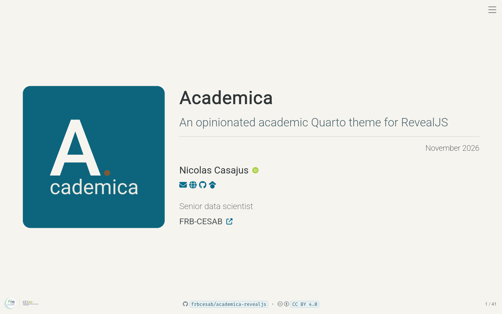

# Academica

### An opinionated academic Quarto theme for RevealJS

**Academica** is an academic presentation theme for [Quarto](https://quarto.org),
built on [RevealJS](https://quarto.org/docs/presentations/revealjs/) and 
distributed as a [Quarto extension](https://quarto.org/docs/extensions/). It 
provides a consistent visual identity and opinionated defaults for creating 
academic presentations.





## Installation

### Existing project

To add **Academica** to an existing Quarto project, run the following command 
in a terminal:

```bash
quarto add frbcesab/academica-revealjs
```

This installs the extension in the `_extensions/` directory of your project.

To use **Academica**, set the following format in the YAML header of your 
`.qmd` file:

```yaml
format: academica-revealjs
```

### New project

**Academica** also provides a starter template to help you create a new 
presentation.

Run the following command in a terminal:

```bash
quarto use template frbcesab/academica-revealjs
```

This creates a new project based on the **Academica** template, ready for you to 
customize.


## Features

**Academica** extends Quarto and RevealJS with a collection of visual 
enhancements and layout utilities:

- **Custom title slide** and **footer** — Flexible layouts with support for 
author profiles, social links, and institutional affiliations.
- **Grid layout** — Flexible grid system for organizing slide content.
- **Custom block quotes** — Enhanced styling for quotations and highlighted 
statements.
- **CSS utility classes** — Classes for controlling element width, size, 
positioning, alignment, and text emphasis.
- **Custom visual identity** — Consistent typography, colors, and styling 
throughout the presentation.

Check out the 
[**demo presentation**](https://frbcesab.github.io/academica-revealjs-demo/) to 
explore all features in action.


## Format options

Use the following YAML options to customize the title slide and the footer:

| Option                         | Description                                   |
| :----------------------------- | :-------------------------------------------- |
| `title`                        | Title of the presentation                     |
| `subtitle`                     | Subtitle of the presentation                  |
| `lang`                         | Language of the presentation                  |
| `date`                         | Date of the presentation                      |
| `date-format`                  | Date display format (e.g. `MMMM YYYY`)        |
| `image`                        | Image displayed on the title slide            |
| `logo`                         | Logo displayed in the bottom-right corner     |
| `favicon`                      | Favicon of the presentation                   |
| `footer`                       | Text displayed in the bottom-center footer    |
| `creators.name`                | Name of the creator (author)                  |
| `creators.position`            | Professional title or position of the creator |
| `creators.socials.<service>`   | URL of the creator's social media profile     |
| `creators.affiliations.name`   | Name of the creator's affiliation             |
| `creators.affiliations.url`    | URL of the creator's affiliation              |

**Note:** Replace `<service>` in `creators.socials.<service>` with one of the following values:  `orcid`, `email`, `website`, `github`, `scholar`


Example:

```yaml
---
format: academica-revealjs

title: "Academica"
subtitle: "An opinionated academic Quarto theme for RevealJS"

footer: >
   
  [`frbcesab/academica-revealjs`](https://github.com/frbcesab/academica-revealjs)
  &nbsp; &bull; &nbsp;
  
   
  [`CC BY 4.0`](https://creativecommons.org/licenses/by/4.0/deed.en)
    
image: "assets/logo-title.png"
logo: "assets/logo-brand.png"
favicon: "assets/favicon-32x32.png"

lang: en
date: today
date-format: "MMMM YYYY"

creators:
  - name: "Nicolas Casajus"
    position: "Senior data scientist"

    socials:
      email: "nicolas.casajus@fondationbiodiversite.fr"
      website: "https://nicolascasajus.fr"
      github: "https://github.com/ahasverus"
      orcid: "0000-0002-5537-5294"
      scholar: "https://scholar.google.fr/citations?user=n1swa1UAAAAJ"

    affiliations:
      - name: "FRB-CESAB"
        url: "https://www.fondationbiodiversite.fr/en/about-the-foundation/le-cesab/"
---
```


## License

This project is released under the MIT license. See [LICENSE](LICENSE) for details.


## Contributing

All types of contributions are encouraged and valued.

Please note that the `academica-revealjs` project is released with a [Contributor Code of Conduct](https://contributor-covenant.org/version/2/1/CODE_OF_CONDUCT.html). By contributing to this project, you agree to abide by its terms.
